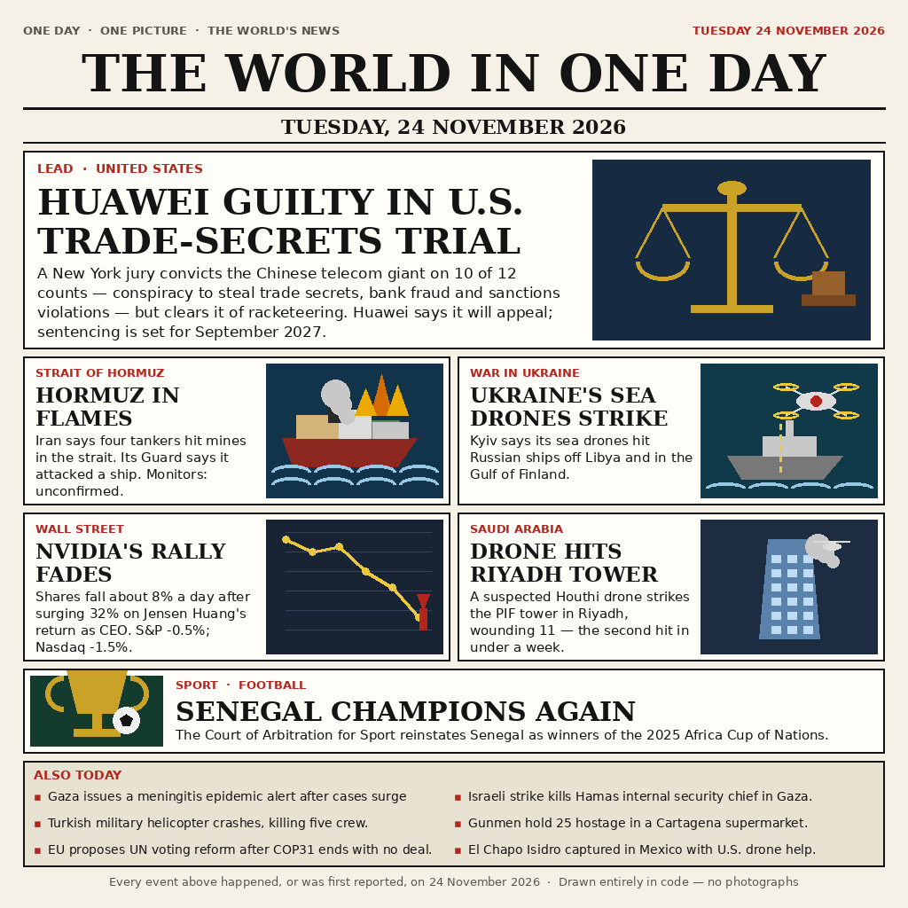

# The World in One Day — Tuesday 24 November 2026

A one-page newspaper front page for Tuesday 24 November 2026, drawn
entirely in code with Python and Pillow (`draw_image.py`, 1024 × 1024).
No photographs or outside images: the scales of justice, the tanker,
the drone, the falling market chart, the tower and the trophy are all
drawn from shapes and text.

## The stories on the page

1. **Lead — Huawei guilty in U.S. trade-secrets trial.** A New York jury
   convicts the Chinese telecom giant on 10 of 12 counts — conspiracy to
   steal trade secrets, bank fraud and sanctions violations — but clears
   it of racketeering. Huawei says it will appeal; sentencing is set for
   September 2027.
2. **Hormuz in flames.** Iran says four tankers hit mines in the Strait
   of Hormuz; its Revolutionary Guard says it attacked a container ship.
   Independent monitors say the claims are unconfirmed.
3. **Ukraine's sea drones strike ships.** Kyiv says its sea drones hit
   Russian ships off Libya and in the Gulf of Finland.
4. **Nvidia's rally fades.** Shares fall about 8% a day after surging
   32% on Jensen Huang's return as chief executive. The S&P 500 slips
   0.5%; the Nasdaq drops 1.5%.
5. **Drone hits Riyadh tower.** A suspected Houthi drone strikes the PIF
   tower in Riyadh's financial district, wounding 11 — the second hit on
   the tower in under a week.
6. **Senegal champions again.** The Court of Arbitration for Sport
   reinstates Senegal as winners of the 2025 Africa Cup of Nations.

The "Also today" strip adds the day's other news: a meningitis epidemic
alert in Gaza, an Israeli strike killing Hamas's internal security chief,
a Turkish military helicopter crash killing five, gunmen holding 25
hostage in a Cartagena supermarket, the EU proposing UN voting reform
after COP31 ends with no deal, and El Chapo Isidro captured in Mexico
with U.S. drone help.

## How it runs

- `python3 draw_image.py` regenerates `entry.png` (deterministic —
  the same bytes every run).
- `main.ts` (Node 22, standard library only) copies `entry.png` to
  `/output/entry.png` (or `$MAKEFUN_OUTPUT_DIR/entry.png` outside the
  grader's container).
